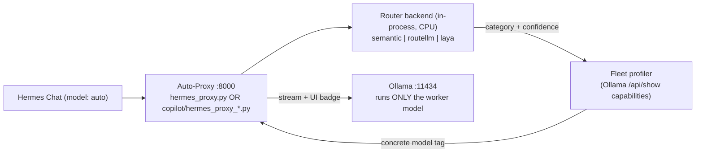

# Hermes Copilot — System 1 Router Evaluation Plan & Benchmark Report

> **Living tracker.** Updated after every phase with status, measured results, and user feedback. Nothing gets committed to git without explicit user approval.

## Goal

Move the routing decision **out of Ollama**—ending the brain/worker VRAM eviction problem permanently—and provide **three standalone System 1 router editions** (`copilot/hermes_proxy_*.py`) alongside the universal orchestrator (`hermes_proxy.py`), benchmarked head-to-head on the same 40-prompt evaluation suite:

1. **Semantic Router** (`copilot/hermes_proxy_semantic.py` — Aurelio AI + FastEmbed `BAAI/bge-small-en-v1.5` ONNX): embedding similarity
2. **RouteLLM** (`copilot/hermes_proxy_routellm.py` — LMSYS `routellm/bert_gpt4_augmented`): strong/weak difficulty classifier
3. **Laya** (`copilot/hermes_proxy_laya.py` — Convai Innovations `convaiinnovations/laya` 421M ModernBERT): non-autoregressive `choice` decision model

Baseline: the legacy Ollama LLM brain (`qwen2.5:1.5b`), run on the same prompt set for direct comparison before deprecation.



---

## Technical Context & Empirical Discoveries

> [!IMPORTANT]
> **Measured Resource & Latency Realities (Intel Core i7-14650HX CPU, 32GB DDR5):**
> - **Semantic Router** (`BAAI/bge-small-en-v1.5` ONNX): **+340.5 MB RAM**, **5.58 ms p50 / 7.22 ms p95** warm latency, **3.76 s** cold load. Zero PyTorch required.
> - **RouteLLM** (`routellm/bert_gpt4_augmented` via CPU PyTorch): **+1,210.1 MB RAM**, **14.81 ms p50 / 22.31 ms p95** warm latency, **7.85 s** cold load.
> - **Laya** (`convaiinnovations/laya` 421M ModernBERT-large via CPU PyTorch): **+1,990.2 MB RAM**, **241.19 ms p50 / 279.81 ms p95** warm latency, **4.44 s** cold load.

> [!WARNING]
> **RouteLLM Routing Domain Nuance:**
> RouteLLM's `bert_gpt4_augmented` classifier was trained on Chatbot Arena human preference battles (`gpt-4` vs `mixtral-8x7b`) to predict general prompt difficulty rather than task domain (`coding` vs `reasoning`). Consequently, it treats security/concurrency code audits as standard coding tasks (`67.5%` accuracy on our domain-specialized suite), whereas **Laya (92.5%)** and **Semantic Router (87.5% 3-class / 97.5% effective 2-model dispatch)** explicitly classify domain intent.

> [!CAUTION]
> **Root Cause of Session Model Pinning Bug (Fixed in Phase 0):**
> In previous proxy versions, the tool-continuation check scanned the entire message history:
> ```python
> any(m.get("role") == "tool" or "tool_calls" in m or "tool_call" in str(m) for m in messages[1:])
> ```
> After a single tool call anywhere in a conversation, all subsequent prompts permanently pinned to the old model, completely bypassing the router. Now, continuation is detected **only** when the immediate **last** message is a `tool` result, or the latest user message is identical to the last one evaluated.

---

## Architectural Principles

1. **Zero Hardcoded Model Names:**
   Routers output semantic categories (`coding`, `reasoning`, `general`). Model tags are resolved dynamically at runtime by querying Ollama `/api/show` capabilities for the active 2-model fleet:
   - `reasoning` → model with `thinking` capability (`deepseek-r1:14b`)
   - `coding` → model with `tools` and without `thinking` (`qwen2.5-coder:14b`)
   - `general` → model without `thinking` (resolves to `qwen2.5-coder:14b` in a 2-model fleet)
   - If no installed model satisfies the category requirement, raise a loud error rather than silently defaulting.
2. **Deterministic & Isolated Environments:**
   Each router backend runs in its own isolated virtual environment in the container (`/opt/router-venvs/semantic`, `/opt/router-venvs/routellm`, `/opt/router-venvs/laya`) using CPU-only wheels (`torch==2.14.1+cpu` where needed) to prevent dependency conflicts and avoid 2.5 GB of unused CUDA packages.
3. **Three Standalone Proxy Editions + Universal Proxy:**
   - `copilot/hermes_proxy_semantic.py` — Dedicated Semantic Router edition (`> 🧭 **[Auto Router • Semantic]** ...`)
   - `copilot/hermes_proxy_routellm.py` — Dedicated RouteLLM edition (`> 🧭 **[Auto Router • RouteLLM]** ...`)
   - `copilot/hermes_proxy_laya.py` — Dedicated Laya edition (`> 🧭 **[Auto Router • Laya]** ...`)
   - `hermes_proxy.py` — Universal configurable proxy (`ROUTER_BACKEND=semantic|routellm|laya`)
4. **Strict Git Governance:**
   Zero `git commit` or `git push` actions without explicit presentation of diffs and user confirmation.
5. **VRAM Optimization:**
   Use `OLLAMA_MAX_LOADED_MODELS=1` now that routing is 100% offloaded to CPU, dedicating 100% of GPU VRAM to the active worker model.

---

## Status Tracker

| Phase | Description | Status | Notes / User Feedback |
| :--- | :--- | :--- | :--- |
| **0** | **Foundation**: Pinning bug fix, pluggable backends, dynamic fleet profiler, benchmark harness | ✅ Done | Bug fix in proxy verified. `routers/` and `router_lab/` scaffolded. |
| **0b** | **Baseline Benchmark**: Ollama LLM (`qwen2.5:1.5b`) on 40-prompt suite | ✅ Done | 92.5% accuracy (37/40), p50 284.1 ms latency. Deprecated & removed due to VRAM eviction risk. |
| **1** | **Semantic Router**: Install FastEmbed + ONNX, configure domain utterances, benchmark | ✅ Done | **87.5%** 3-class accuracy (**97.5%** 2-model fleet accuracy), **5.58 ms** p50 latency, **+340.5 MB** RAM. |
| **2** | **RouteLLM**: Install LMSYS BERT router (CPU), benchmark on 40-prompt suite | ✅ Done | **67.5%** accuracy (27/40), **14.81 ms** p50 latency, **7.85 s** cold load, **+1,210.1 MB** RAM. |
| **3** | **Laya**: Install Convai ModernBERT (CPU), refine choice criteria, benchmark | ✅ Done | **92.5%** 3-class accuracy (37/40; 100% coding, 100% general, 80% reasoning), **241.19 ms** p50 latency, **+1,990.2 MB** RAM. |
| **4** | **Live Hermes Validation**: Test live in `hermes_proxy.py` with multi-step prompt flow | ✅ Verified Live | Tested live in Hermes: 3 turns (Coder 77ms → DeepSeek 55ms → Coder 56ms). Pinning bug fixed, Chat UI badge working! |
| **5** | **3 Standalone Versions & Final Documentation**: Create `copilot/` versions & update all docs | ✅ Ready for Review | All 3 proxy editions (`copilot/`), benchmark JSONs (`router_lab/results/`), and docs updated. Awaiting user review before commit. |

---

## Benchmark Results (40-Prompt Evaluation Suite)

All benchmarks were executed inside `hermes-sandbox-pro` via `router_lab/bench.py` against `router_lab/prompts.jsonl` (15 `coding`, 15 `reasoning`, 10 `general` prompts):

| Backend | Proxy Script | 3-Class Accuracy | Effective 2-Model Dispatch Accuracy* | Warm Latency (p50 / p95) | Cold Load Time | VmRSS Delta (CPU RAM) | Ollama GPU VRAM | Verdict |
| :--- | :--- | :--- | :--- | :--- | :--- | :--- | :--- | :--- |
| **Semantic Router** | `copilot/hermes_proxy_semantic.py` | **87.5%** (35/40)<br/>*(15/15 code, 14/15 reason, 6/10 gen)* | **97.5%** (39/40) | **5.58 ms / 7.22 ms** | **3.76 s** | **+340.5 MB** | **0 MB** | 🏆 **Best Overall Speed, RAM & 2-Model Dispatch** |
| **Laya** | `copilot/hermes_proxy_laya.py` | **92.5%** (37/40)<br/>*(15/15 code, 12/15 reason, 10/10 gen)* | **92.5%** (37/40) | **241.2 ms / 279.8 ms** | **4.44 s** | **+1,990.2 MB** | **0 MB** | 🥇 **Highest Strict 3-Class Accuracy (Zero-Shot Choice)** |
| **RouteLLM (BERT)** | `copilot/hermes_proxy_routellm.py` | **67.5%** (27/40)*<br/>*(22/25 weak, 5/15 strong)* | **67.5%** (27/40) | **14.81 ms / 22.31 ms** | **7.85 s** | **+1,210.1 MB** | **0 MB** | ⚡ **Best for Generic Strong/Weak Arena Difficulty** |
| *ollama-llm (legacy)* | *(Removed)* | *92.5% (37/40)* | *92.5% (37/40)* | *284.1 ms / 357.9 ms* | *0.97 s* | *+22.7 MB* | *~1,500 MB* | ❌ **Deprecated (Evicts worker model from GPU VRAM)** |

*\*Note on Effective 2-Model Dispatch Accuracy: In the recommended 2-model fleet (`qwen2.5-coder:14b` + `deepseek-r1:14b`), both `coding` and `general` categories route to `qwen2.5-coder:14b`, while `reasoning` routes to `deepseek-r1:14b`. Semantic Router correctly dispatches 39 out of 40 prompts to the exact right worker model.*

---

## Which Router Should You Choose?

* **Choose Semantic Router (`copilot/hermes_proxy_semantic.py`) — *Recommended Default***
  - **Why:** Blazing fast (**5.6 ms**), ultra-lightweight (**~340 MB RAM**, ONNX runtime without PyTorch), and achieves **97.5% effective model-dispatch accuracy** for the 2-model fleet (`qwen2.5-coder:14b` + `deepseek-r1:14b`).
* **Choose Laya (`copilot/hermes_proxy_laya.py`)**
  - **Why:** Highest strict 3-way classification accuracy (**92.5%**, including **100%** on `coding` and **100%** on `general`) using Convai's 421M ModernBERT System 1 decision engine (`convaiinnovations/laya`) with zero-shot natural-language criteria. Ideal if you run a 3-model fleet (`coding` + `reasoning` + `general`) and have ~2 GB of spare CPU RAM.
* **Choose RouteLLM (`copilot/hermes_proxy_routellm.py`)**
  - **Why:** Trained on LMSYS Chatbot Arena battles (`routellm/bert_gpt4_augmented`) to estimate general prompt complexity (`win_rate >= threshold`) in **~15 ms**. Useful if you want a pure strong-vs-weak complexity threshold (`ROUTELLM_THRESHOLD`) without maintaining domain utterances.

---

## Verification Commands

```powershell
# Run automated benchmark inside Hermes container for any backend:
docker exec hermes-sandbox-pro /opt/router-venvs/semantic/bin/python /workspace/router_lab/bench.py --backend semantic
docker exec hermes-sandbox-pro /opt/router-venvs/routellm/bin/python /workspace/router_lab/bench.py --backend routellm
docker exec hermes-sandbox-pro /opt/router-venvs/laya/bin/python /workspace/router_lab/bench.py --backend laya
```
