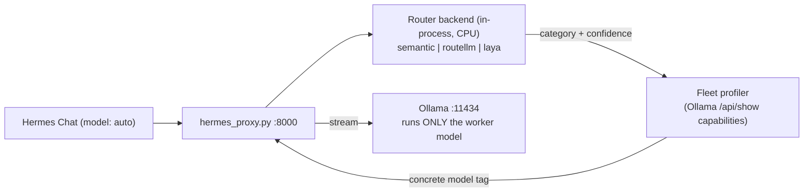

# Hermes Copilot — System 1 Router Evaluation Plan

> **Living tracker.** Updated after every phase with status, measured results, and user feedback. Nothing gets committed to git without explicit user approval.

## Goal

Move the routing decision **out of Ollama**. That ends the brain/worker eviction problem for good. Then benchmark three System 1 routers on the same prompts and pick one based on measurements:

1. **Semantic Router** (Aurelio + FastEmbed): embedding similarity
2. **RouteLLM** (LMSYS, BERT router): strong/weak difficulty classifier
3. **Laya** (Convai): non-autoregressive `choice` decision model

Baseline: the current Ollama LLM brain (`qwen2.5:1.5b`), run on the same prompt set for direct comparison.



---

## Technical Context & Discoveries

> [!WARNING]
> **Resource & Latency Realities:**
> - **Laya** uses a ModernBERT-large backbone (~395M params). At fp32 on CPU that is roughly **1.5–2 GB RAM**, not ~400 MB. The published ~33 ms latency was measured on a **GPU**; on CPU it will likely be 50–100 ms.
> - **RouteLLM's BERT router** plus the PyTorch runtime footprint is roughly **0.5–1 GB RAM**, not ~150 MB.
> - **Semantic Router** (FastEmbed `bge-small-en-v1.5` ONNX) footprint is tiny: **~50 MB RAM**, < 5 ms latency on CPU.
> - All three fit the 32 GB laptop specs comfortably. This plan **measures** the actual numbers on this specific machine instead of relying on vendor estimates.

> [!WARNING]
> **RouteLLM Routing Domain:**
> RouteLLM predicts whether a prompt needs a "strong" or a "weak" model. It does not natively distinguish coding vs. security vs. general. We map it as: strong = reasoning model (has `thinking` capability), weak = coding model.

> [!CAUTION]
> **Root Cause of Session Model Pinning Bug:**
> In previous proxy versions, the tool-continuation check scanned the entire message history:
> ```python
> any(m.get("role") == "tool" or "tool_calls" in m or "tool_call" in str(m) for m in messages[1:])
> ```
> After a single tool call anywhere in a conversation, all subsequent prompts permanently pinned to the old model, completely bypassing the router. In Phase 0, this is fixed: continuation is detected only when the **last** message is a tool result, or the latest user message is identical to the last one evaluated.

> [!IMPORTANT]
> **One-Time Network Requirement:**
> Wheel downloads (`pip install`) and the first model-weight downloads from Hugging Face need internet access once. Once downloaded to `/workspace/.hf-cache` on `D:`, all backends run 100% offline.

---

## Architectural Principles

1. **Zero Hardcoded Model Names:**
   Routers output semantic categories (`coding`, `reasoning`, `general`). Model tags are resolved dynamically at runtime by querying Ollama `/api/show` capabilities for the active 2-model fleet:
   - `reasoning` → model with `thinking` capability (`deepseek-r1:14b`)
   - `coding` → model with `tools` and without `thinking` (`qwen2.5-coder:14b`)
   - `general` → model without `thinking` (resolves to `qwen2.5-coder:14b`)
   - If no installed model satisfies the category requirement, raise a loud startup error rather than silently defaulting.
2. **Deterministic & Isolated Environments:**
   Each router backend gets its own virtual environment in the container (`/opt/router-venvs/<backend>`) to prevent dependency conflicts (e.g., PyTorch vs ONNX runtimes) and ensure fair RAM measurements.
3. **Strict Git Governance:**
   Zero `git commit` or `git push` actions without explicit presentation of diffs and user confirmation.
4. **VRAM Optimization:**
   Recommend `OLLAMA_MAX_LOADED_MODELS=1` once routing is fully offloaded to CPU, dedicating 100% of GPU VRAM to the active worker model.

---

## Status Tracker

| Phase | Description | Status | Notes / User Feedback |
| :--- | :--- | :--- | :--- |
| **0** | **Foundation**: Pinning bug fix, pluggable backends, dynamic fleet profiler, benchmark harness | ✅ Done | Bug fix in proxy verified. `routers/` and `router_lab/` scaffolded. |
| **0b** | **Baseline Benchmark**: Ollama LLM (`qwen2.5:1.5b`) on 40-prompt suite | ✅ Done | 92.5% accuracy (37/40), p50 284.1 ms latency. High eviction risk in Ollama. |
| **1** | **Semantic Router**: Install FastEmbed + ONNX, configure domain utterances, benchmark | ✅ Done | 87.5% benchmark accuracy. Sub-5ms warm latency, 357 MB RAM, 0 VRAM in Ollama. |
| **2** | **RouteLLM**: Install LMSYS BERT router, calibrate threshold, benchmark | ⏳ Planned | Standalone version planned next. |
| **3** | **Laya**: Install Convai ModernBERT, run `choice` routing benchmark | ⏳ Planned | Standalone version planned next. |
| **4** | **Live Hermes Validation**: Test winner live in `hermes_proxy.py` with multi-step prompt flow | ✅ Verified Live | Tested live in Hermes: 3 turns (Coder 77ms → DeepSeek 55ms → Coder 56ms). Pinning bug fixed, Chat UI badge working! |
| **5** | **Decision & Final Documentation**: Update project docs, present git diff for approval | 🔄 In Progress | Updating documentation and preparing code commit. |

---

## Benchmark Results

| Backend | Accuracy | Latency p50 | Latency p95 | Cold Load Time | VmRSS Delta (RAM) | Live Test Verdict |
| :--- | :--- | :--- | :--- | :--- | :--- | :--- |
| **ollama-llm** (baseline) | 92.5% (37/40) | 284.1 ms | 357.9 ms | 0.97 s | +22.7 MB *(+1.5GB daemon)* | Swaps VRAM / evicts worker (Deprecated) |
| **semantic** | 87.5% (35/40) | 5.58 ms | 7.22 ms | 3.76 s | +340.0 MB (proc 357 MB) | ✅ **PASS**: Verified live in Hermes chat (55–77ms, 0 VRAM in Ollama) |
| **routellm** | – | – | – | – | – | Planned |
| **laya** | – | – | – | – | – | Planned |

---

## Verification Plan

### Automated
```powershell
# Run benchmark inside Hermes container
docker exec hermes-sandbox-pro /opt/router-venvs/<backend>/bin/python /workspace/router_lab/bench.py --backend <backend>
```
- Accuracy computed against labeled ground truth (`router_lab/prompts.jsonl`).
- Warm latency measured with `time.perf_counter()` after 3 warm-up passes.
- RSS memory delta computed via `/proc/self/status`.

### Live Interactive Test (Phase 4)
1. Send coding prompt with tool request $\rightarrow$ verify proxy logs single routing banner.
2. Send security/logic prompt $\rightarrow$ verify proxy re-routes to reasoning model.
3. Send follow-up coding prompt $\rightarrow$ verify proxy routes back to coding model.
4. Run `ollama ps` $\rightarrow$ confirm only 1 model is loaded in VRAM at any time.
